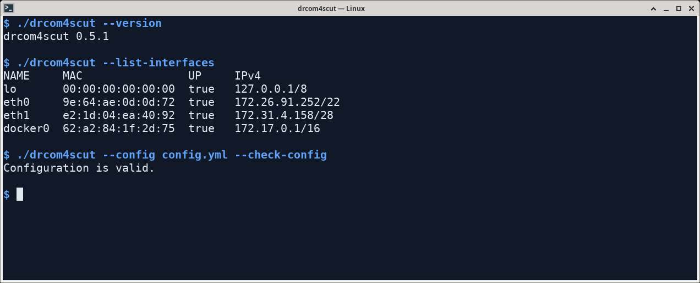

# drcom4scut

**连接华南理工大学校园网，日常联网更省心。** 支持 Windows、macOS、Linux 和 OpenWrt；填好账号后自动保持连接，断线时继续尝试恢复。

[软件首页](https://SeaLoong.github.io/drcom4scut/) · [下载程序](docs/download.md) · [使用帮助](docs/getting-started.md) · [连接问题](docs/troubleshooting.md)

## 选一种适合你的用法

电脑上推荐使用 **[drcom4scutGUI 图形界面](https://github.com/SeaLoong/drcom4scutGUI)**：填写账号、选择网卡，点击“连接”即可。桌面一体包已包含图形界面和命令行程序，解压后可以选择任一种操作方式；路由器使用包含 LuCI 管理页的 OpenWrt 包。

| 你的设备 | 用窗口和按钮连接 | 用终端或后台服务连接 |
| --- | --- | --- |
| **Windows 电脑** | [Windows 图形界面安装](https://github.com/SeaLoong/drcom4scutGUI/blob/master/docs/windows.md) | [Windows 命令行](docs/windows.md) · [开机后台服务](docs/windows-service.md) |
| **Mac** | [Mac 图形界面安装](https://github.com/SeaLoong/drcom4scutGUI/blob/master/docs/macos.md) | [Mac 命令行](docs/macos.md) |
| **Linux 电脑** | [Linux 图形界面安装](https://github.com/SeaLoong/drcom4scutGUI/blob/master/docs/linux.md) | [Linux 命令行](docs/linux.md) |
| **OpenWrt 路由器** | [LuCI 网页管理](docs/openwrt.md#luci-管理页) | [安装与开机连接](docs/openwrt.md) |

*Linux 命令行运行示例：查看版本、选择网卡并检查配置。*

## 能帮你做什么？

- **有线联网**：完成校园网认证并持续保持连接，适合宿舍网口、电脑和路由器。
- **自动恢复**：网线重新接好、网络地址变化或连接中断后，自动尝试重新连接。
- **方便查看**：图形界面显示连接进度；终端和路由器提供状态查询与运行日志。
- **按习惯启动**：电脑可登录系统后打开图形界面，Windows 服务和 OpenWrt 可在后台运行。
- **校园网页登录**：连接 Wi-Fi 后，可代为提交受支持的 DrCOM/ePortal 账号密码页面，见[无线使用方法](docs/portal.md)。

## 第一次使用

1. **下载匹配的程序。** 打开上表中对应系统的安装指南。电脑下载一个桌面一体包，里面已备好界面和命令行程序；OpenWrt 下载路由器包。
2. **接好校园网，完成首次准备。** 有线插好网线，按指南安装驱动或授权网卡；在图形界面点击“环境自检”，或按命令行指南运行检查命令。
3. **填写账号并连接。** 选择连接学校网线的网卡，填写学校提供的完整账号和密码，等待显示在线。

打开 GitHub 下载页，展开所选版本的 **Assets（下载文件）**，电脑选择文件名含 **`desktop`** 的一体包；**Pre-release** 表示开发预览版。每个系统该选哪个文件，见[下载对照表](docs/download.md)。

校园 Wi-Fi 仍按熟悉的方式使用：先连接无线网络，再打开学校登录页。想让客户端代为登录时，按[校园网页登录](docs/portal.md)设置。

## 已经装好，接下来怎么用？

| 想做什么 | 查看这里 |
| --- | --- |
| 在终端填写账号、开始和结束连接 | [命令行快速开始](docs/getting-started.md) |
| 下载或替换程序 | [下载选择](docs/download.md) |
| 检查新版本、更新程序 | [更新方法](docs/update.md) |
| 连接失败、经常掉线、找不到网卡 | [连接与排障](docs/troubleshooting.md) |
| 调整日志、重连时间或其他设置 | [配置参考](docs/configuration.md) |
| 反馈问题 | [核心问题反馈](https://github.com/SeaLoong/drcom4scut/issues) · [图形界面问题反馈](https://github.com/SeaLoong/drcom4scutGUI/issues) |

参与开发可阅读[开发指南](docs/development.md)、[更新记录](CHANGELOG.md)和[参考来源](docs/references-clients.md)。项目采用 [LGPL-3.0-or-later](LICENSE) 许可证。
