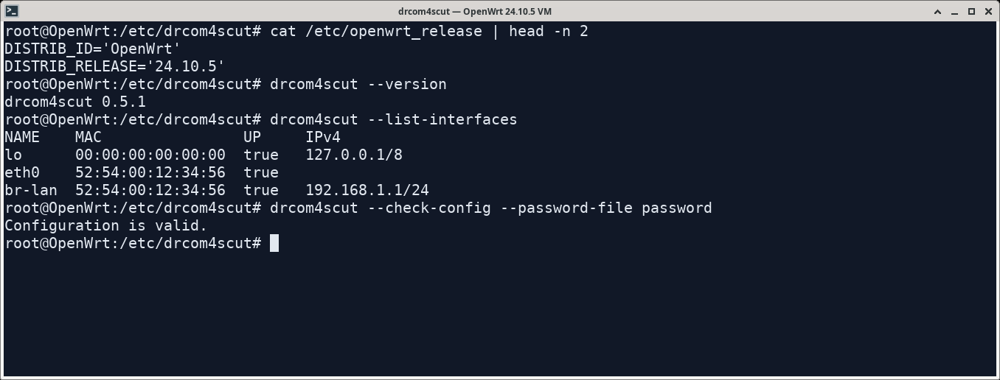
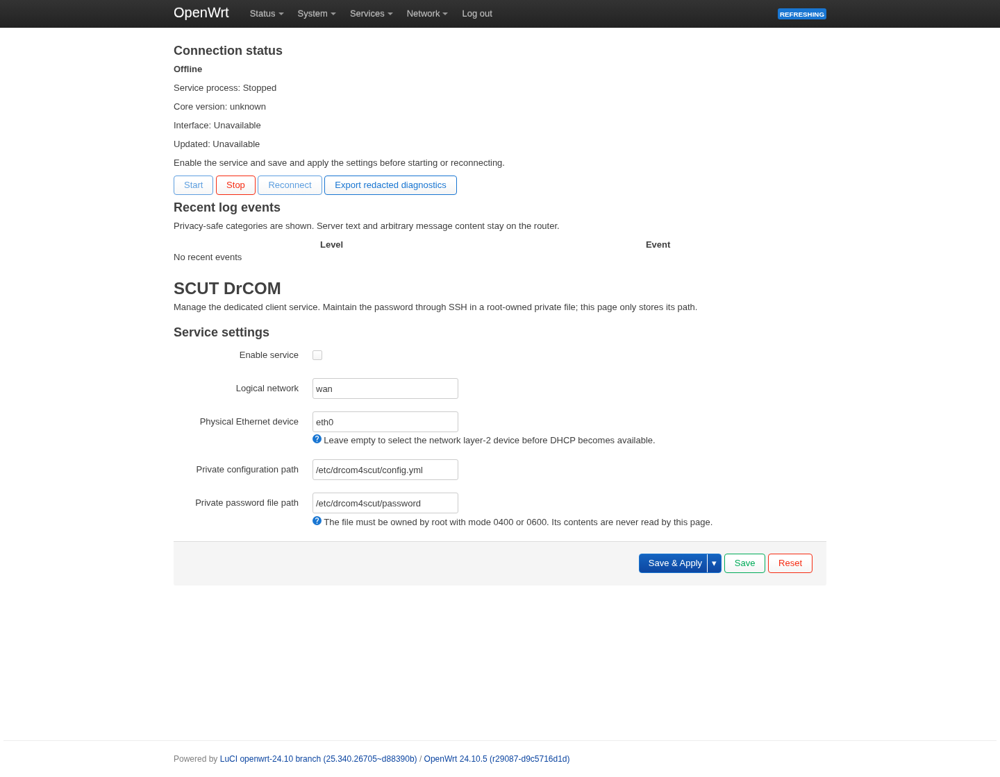

# OpenWrt 安装与使用

[返回首页](../README.md) · [路由器网页管理](#luci-管理页)

本页适合希望由 **OpenWrt 路由器**持续进行校园网认证的用户。电脑用户可直接使用[图形界面](https://github.com/SeaLoong/drcom4scutGUI)。

下载包已包含可运行的认证程序和后台启动脚本，不用在路由器安装 Rust。路由器仍需先接好学校网线，完成自己的网络地址设置。网页管理页（LuCI）是可选的，安装认证程序后再添加即可。



*在 OpenWrt 24.10.5 虚拟机中实际完成安装检查，使用示例配置。下文介绍如何在自己的路由器上操作。*

## 选择程序

先确认路由器的处理器类型，再选择对应程序包。通过 SSH 登录路由器：在电脑终端执行 `ssh root@路由器地址`，把地址换成实际管理地址；密码为路由器管理密码。在路由器中运行：

```sh
ubus call system board
uname -m
opkg print-architecture
```

这些命令显示设备型号、处理器类型和系统支持的软件包类型。使用 `apk` 管理软件的固件，将最后一条换成 `apk --print-arch`。按输出和设备规格确认后，从[下载页](https://github.com/SeaLoong/drcom4scut/releases)的最新正式版选择以下 `.tar.gz` 包，文件名中包含对应版本号。

| 文件名中的这段文字 | 适用设备 |
| --- | --- |
| `x86_64-unknown-linux-musl` | 使用 x86-64 处理器的软路由 |
| `aarch64-unknown-linux-musl` | ARM64 路由器 |
| `armv7-unknown-linux-musleabi` | ARMv7，采用 soft-float 运行约定 |
| `armv5te-unknown-linux-musleabi` | 支持 ARMv5TE 指令的设备 |
| `riscv64gc-unknown-linux-musl` | 支持 GC 扩展的 64 位 RISC-V 设备 |

当前提供上表五类处理器的包。ARMv5 设备选择 ARMv5TE 包，RISC-V 设备需支持 GC 指令扩展。选择时一并核对设备规格和固件；需要帮助时提供上述命令输出与设备型号。MIPS/MIPSEL 设备可选择面向这些处理器的其他客户端；开发者可查阅 [Rust 平台要求](https://doc.rust-lang.org/rustc/platform-support.html)。

## 安装与账号配置

先下载对应包及同一版本的 `SHA256SUMS`，按[校验方法](configuration.md#检查下载的文件)确认文件完整。接下来把压缩包上传到路由器。下面以 x86-64 软路由、版本 0.5.1 和管理地址 `192.168.1.1` 为例；替换为自己的文件名和地址。

在**电脑的 PowerShell 或终端**中，进入下载目录，执行：

```sh
scp -O drcom4scut-0.5.1-x86_64-unknown-linux-musl.tar.gz root@192.168.1.1:/tmp/
ssh root@192.168.1.1
```

第一条上传文件，第二条登录路由器，输入的是路由器管理密码。`-O` 使用 OpenWrt 常见的文件传输方式，也可以用自己熟悉的文件传输软件上传到 `/tmp/`。

登录后，在**路由器终端**解压并进入程序目录：

```sh
cd /tmp
tar -xzf drcom4scut-0.5.1-x86_64-unknown-linux-musl.tar.gz
cd drcom4scut-0.5.1-x86_64-unknown-linux-musl
```

在解压后的目录中运行安装器：

```sh
sh openwrt/install.sh
```

安装器会检查程序能否运行，再把程序放到 `/usr/bin/drcom4scut`，安装后台启动脚本；这时还不会开始认证。原来已有的账号文件和服务设置会保留，密码文件同时设为仅管理员可读写的 `0600` 权限。

1. 用文本编辑器打开 `/etc/drcom4scut/config.yml`，把 `username` 改成自己的完整校园网账号，其他设置先保持默认。
2. 在 `/etc/drcom4scut/password` 中只写一行校园网密码，保存为 UTF-8 纯文本。可以在 SSH 中使用 `vi /etc/drcom4scut/password`：按 `i` 输入，按 Esc 后输入 `:wq` 并回车保存。账号配置也可用相同编辑器修改。
3. 执行下列命令，确保只有路由器管理员能读取配置和密码：

   ```sh
   chown root:root /etc/drcom4scut /etc/drcom4scut/config.yml /etc/drcom4scut/password
   chmod 700 /etc/drcom4scut
   chmod 600 /etc/drcom4scut/config.yml /etc/drcom4scut/password
   ```

默认路径已适合日常使用。账号设置在 `config.yml`，密码在 `password`，两者均由路由器管理员保存；上面的命令会完成所需文件权限设置。更多选项见[配置参考](configuration.md)。

## 网卡与启动

先列出网卡，找出连接学校网线的实际设备：

```sh
/usr/bin/drcom4scut --list-interfaces
```

服务默认使用 OpenWrt 的 `wan` 网络，由系统找到它对应的网卡。这里的 `wan` 是路由器网络设置的名称，不一定等于 `eth0` 这样的设备名。如果默认选择正确，不必改它。

只有确认需要指定某个网卡或 VLAN 时，再修改如下设置。`uci` 是 OpenWrt 保存设置的命令：

```sh
uci set drcom4scut.main.network='wan'
uci set drcom4scut.main.interface='eth0.2'
uci commit drcom4scut
```

把 `eth0.2` 换成实际网卡名；留空 `interface` 则让系统继续选择。VLAN、桥接、路由和自动获取地址在 OpenWrt 网络设置中配置。

**先让所选网卡取得 IPv4 地址，再开始有线认证。** 在 OpenWrt 的“网络 → 接口”中完成学校要求的地址配置，然后运行 `drcom4scut --list-interfaces` 确认列表中能看到它。

先检查账号配置，再允许后台运行并启动：

```sh
/usr/bin/drcom4scut --check-config --config /etc/drcom4scut/config.yml --password-file /etc/drcom4scut/password
uci set drcom4scut.main.enabled='1'
uci commit drcom4scut
/etc/init.d/drcom4scut enable
/etc/init.d/drcom4scut start
logread -e drcom4scut
```

第一条只检查填写内容，不会登录。后面依次保存“启用”、设置开机运行、启动认证和查看日志。系统的后台进程管理器（procd）负责保持程序运行，网络管理器（netifd）通知它网络发生了变化。

“程序已运行”还不等于学校已接受认证。查看连接状态，以及重启或停止的方法如下：

| 要做的事 | 在路由器上执行 |
| --- | --- |
| 查看认证状态 | `/usr/bin/drcom4scut status --status-file /var/run/drcom4scut/status.json` |
| 重新认证 | `/etc/init.d/drcom4scut restart` |
| 停止这次运行 | `/etc/init.d/drcom4scut stop` |
| 查看最近事件 | `logread -e drcom4scut` |

状态文件仅供 root 读取。要同时关闭开机启动和自动运行，执行：

```sh
uci set drcom4scut.main.enabled='0'
uci commit drcom4scut
/etc/init.d/drcom4scut stop
/etc/init.d/drcom4scut disable
```

手动运行程序排查问题前，先停止后台服务，避免同一网卡有两个认证客户端。

## LuCI 管理页

LuCI 就是浏览器中打开的 OpenWrt 管理界面。装好本项目的页面后，可以在其中看状态、启动、停止、重新连接和下载诊断信息。



*OpenWrt 24.10.5 的实际管理页面。截图时服务尚未启动，因此显示 Offline；填写自己的账号后，按下面的步骤开始认证。*

路由器需要已安装 `luci-base`、`rpcd`、`jshn`、`logd`。在同一个解压后的路由器包目录运行：

```sh
sh openwrt/install-luci.sh
```

重新登录路由器管理网页，打开 **服务 → SCUT DrCOM**。先勾选 **Enable service（启用服务）**，点击 **Save & Apply（保存并应用）**，再点击 **Start（启动）**。账号密码按上文通过 SSH 保存，网页负责日常连接管理。

| 页面上的文字 | 用途 |
| --- | --- |
| `Start` | 开始连接 |
| `Stop` | 停止本次运行 |
| `Reconnect` | 重新开始认证 |
| `Connection status` | 查看连接阶段；`Online` 表示认证在线 |
| `Updated` | 查看这份状态的更新时间 |
| `Export redacted diagnostics` | 下载已筛选的诊断信息，方便反馈问题 |

网页可用于各类处理器，配合对应架构的认证程序使用。详细按钮和排障说明见 [LuCI 管理页说明](https://github.com/SeaLoong/drcom4scut/blob/master/packaging/openwrt/luci-app-drcom4scut/README.md)。

## 无线门户、维护与排障

使用校园 Wi-Fi 时，先在路由器网络设置中连接无线网络，再按[校园网页登录指南](portal.md)配置自动登录。路由器包支持 HTTPS 入口并检查网站证书，通常由系统的 `ca-bundle` 提供可信证书。

替换程序前先停止服务，备份 `/etc/drcom4scut/` 和服务设置，再从新包目录执行安装器。确认账号、程序版本和文件权限后重新启动。默认示例不持续写文件日志，以减少路由器存储写入；日常查看 `logread -e drcom4scut` 即可。

| 遇到的问题 | 下一步 |
| --- | --- |
| 程序无法运行或提示格式错误 | 重新确认处理器、包文件名和最低系统要求 |
| 网卡未准备好 | 检查 `wan` 是否接对学校网线，实际网卡是否已有 IPv4 |
| 启动被拒绝 | 检查 `/etc/drcom4scut/`、配置和密码的所有者、权限及文件名 |
| 程序运行但仍不能联网 | 看认证状态和最近事件，再核对账号、模式及学校网络要求 |

报告问题时提供设备型号、固件版本、程序版本和去掉账号密码后的错误信息。需要自己编译时，见[开发文档](https://github.com/SeaLoong/drcom4scut/blob/master/docs/development.md#openwrt-交叉构建)。
