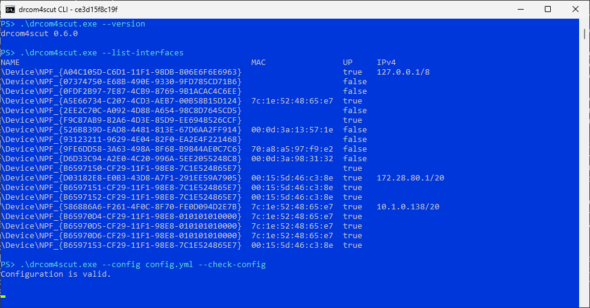

# Windows 命令行使用

[返回首页](../README.md) · [使用图形界面](https://github.com/SeaLoong/drcom4scutGUI/blob/master/docs/windows.md)

本页带你在 Windows PowerShell 中完成第一次有线连接。喜欢窗口操作时，使用上面的图形界面指南；希望电脑开机后、登录 Windows 前就联网时，完成本页后再看[后台服务](windows-service.md)。



*Windows PowerShell 运行示例，使用示例配置，尚未进行校园网认证。*

## 1. 下载并打开程序目录

在 **设置 → 系统 → 关于** 查看“系统类型”，从[下载页](https://github.com/SeaLoong/drcom4scut/releases)选择文件名包含 **`desktop`** 的桌面一体包：

| 系统类型 | 选择文件名以此结尾的包 |
| --- | --- |
| 基于 x64 的处理器（Intel / AMD） | `win-x64.zip` |
| 基于 ARM 的处理器 | `win-arm64.zip` |

展开所选版本的 **Assets**，下载对应的桌面一体包；带 **Pre-release** 标记的是预览版。右键压缩包选择“全部解压”，放在自己的用户文件夹，例如“文档”下的 `drcom4scut` 文件夹。包内已有 `drcom4scutGUI.exe` 和 `drcom4scut.exe`：双击前者使用窗口，下面用后者完成命令行操作。

在解压后的文件夹空白处右键，选择 **在终端中打开**，使用 Windows PowerShell 标签页。输入下面的命令，看到版本号即表示程序可以运行：

```powershell
.\drcom4scut.exe --version
```

如果需要手动切换目录，可在 PowerShell 中输入 `cd `，将解压后的文件夹拖入终端，再按回车。

## 2. 接好网线，检查网卡

有线认证需要 [Npcap](https://npcap.com/#download)。下载安装后，插好连接校园网的网线，在 Windows 网络设置中确认“以太网”已连接。

列出可用网卡：

```powershell
.\drcom4scut.exe --list-interfaces
```

从 `NAME` 一列复制连接学校网线的网卡名称，通常形如 `\Device\NPF_{…}`。如果有几张网卡，可以比较 Windows“高级网络设置”里以太网的硬件地址与列表中的 `MAC`。

检查这张网卡，把引号里的文字换成刚复制的完整名称：

```powershell
.\drcom4scut.exe doctor --interface '实际网卡名称'
```

出现 `capture=ok` 表示网卡访问检查通过。此时还没有提交校园网账号。若提示 Npcap 或访问权限问题，先完成驱动安装或请管理员调整 Npcap 的访问设置，再运行一次检查。

## 3. 填写账号和密码

在同一个 PowerShell 窗口生成设置文件，然后用记事本打开：

```powershell
.\drcom4scut.exe init --config config.yml
notepad .\config.yml
```

修改模板中的以下三项，其余设置先保留默认。网卡名称使用单引号，可以原样保留反斜杠：

```yaml
username: '你的校园网账号'
password_file: password.txt
interface: '从 NAME 一列复制的完整网卡名称'
```

保存 `config.yml`，再创建密码文件：

```powershell
notepad .\password.txt
```

只填写一行校园网密码，保存为 **UTF-8**；若编辑器区分“UTF-8”和“UTF-8 with BOM”，选前者。文件名为 `password.txt`，与配置中一致。账号与密码文件放在自己的用户目录中，后续启动时程序会读取这两份设置。

## 4. 检查设置，开始连接

依次运行：

```powershell
.\drcom4scut.exe --config config.yml --check-config
.\drcom4scut.exe --config config.yml --status-file status.json
```

第一条显示 `Configuration is valid.` 后，运行第二条开始认证。保持窗口打开，等待程序报告完整连接成功。以后连接时，直接运行第二条即可；网络中断时程序会继续尝试恢复。

另开一个 PowerShell 窗口并进入同一目录，可以查看当前结果和最近日志：

```powershell
.\drcom4scut.exe status --status-file status.json
.\drcom4scut.exe logs --config config.yml
```

状态中 `online` 为 `true` 表示校园网认证已完成，`updated_at` 是这份结果的更新时间。结束时回到运行认证的窗口，按 **Ctrl-C**。

## 常见情况

| 看到什么 | 下一步 |
| --- | --- |
| PowerShell 提示找不到程序 | 确认当前目录里有 `drcom4scut.exe`，命令开头使用 `.\` |
| 程序提示缺少 Npcap | 安装官方 Npcap，再运行网卡检查 |
| 网卡没有可用地址 | 在 Windows 网络设置中检查以太网和地址获取方式 |
| 提示找不到密码文件 | 检查实际文件名是否为 `password.txt`，以及它是否与 `config.yml` 放在一起 |
| 账号设置有效，但认证未成功 | 看最新日志，核对账号后缀、密码和所选网卡，按[连接与排障](troubleshooting.md)继续检查 |

连接校园 Wi-Fi 时先在 Windows 中加入无线网络，再按[校园网页登录](portal.md)使用网页认证；这种方式使用普通网络连接。

运行 `.\drcom4scut.exe --check-update` 可查看最新正式版，`.\drcom4scut.exe --update` 发现新版后直接安装。重启后使用新版，账号和配置继续保留，见[更新指南](update.md)。
